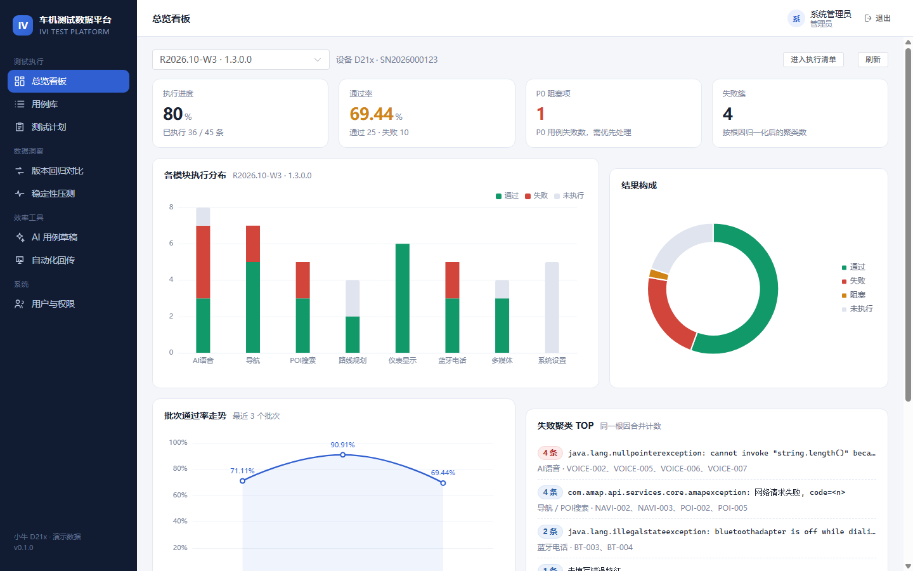
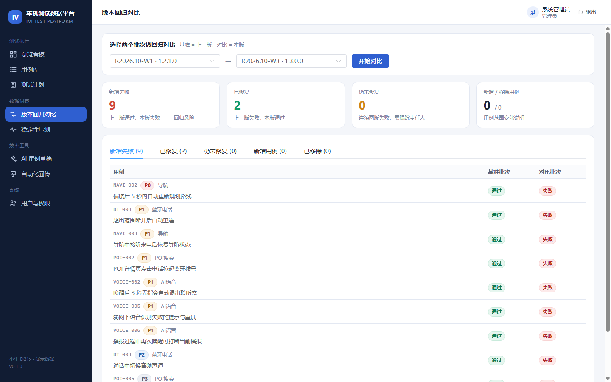
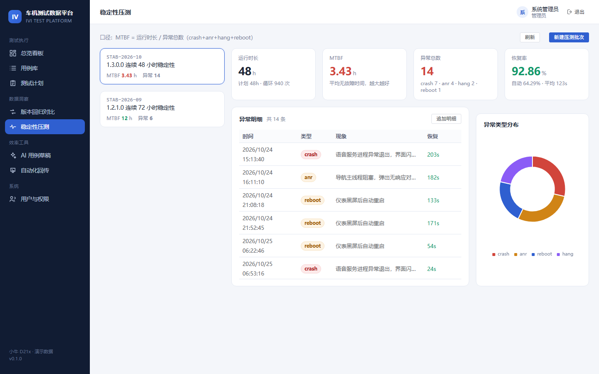
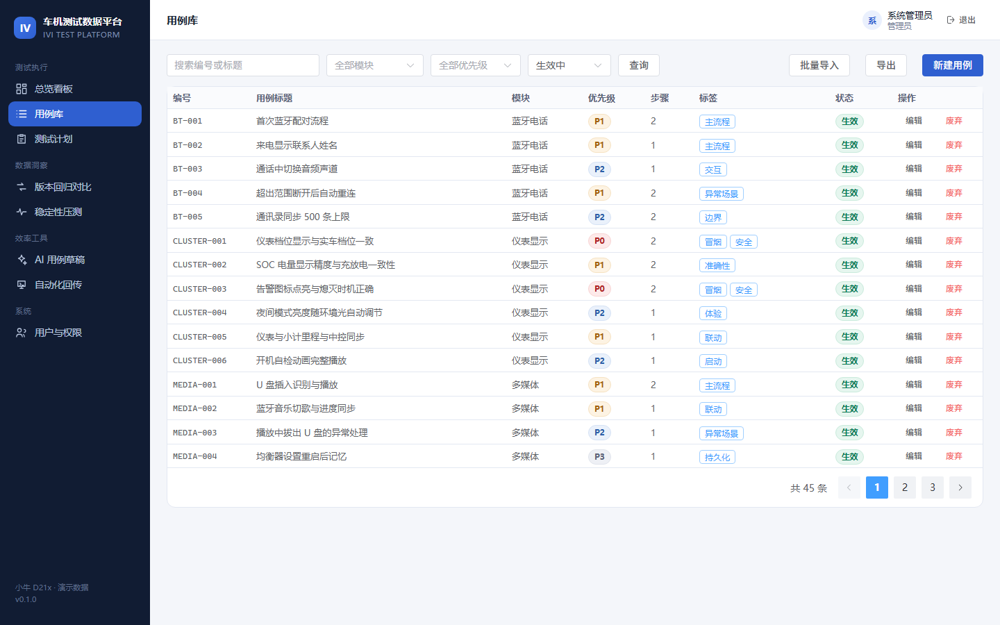
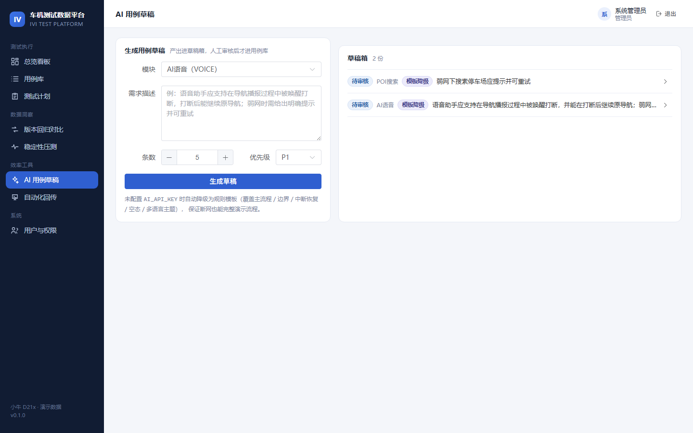

# 车机测试数据平台（IVI Test Platform）

面向智能座舱 / 仪表（如 D21x）的测试数据平台：把散在 Excel 里的测试用例、手工执行记录、
Appium 自动化结果、稳定性压测数据统一入库，支持失败根因聚类、版本回归 diff 与 AI 辅助生成用例。

后端 FastAPI + SQLModel + PostgreSQL，前端 Vue 3 + TypeScript + Element Plus + ECharts。



## 目录

- [为什么做这个](#为什么做这个)
- [功能](#功能)
- [技术栈](#技术栈)
- [架构](#架构)
- [关键设计决策](#关键设计决策)
- [快速开始](#快速开始)
- [演示账号](#演示账号)
- [测试与质量](#测试与质量)
- [数据库迁移](#数据库迁移)
- [目录结构](#目录结构)
- [已知取舍与 Roadmap](#已知取舍与-roadmap)

## 为什么做这个

车机测试的实际痛点不是「缺工具」，而是**数据不在一处、失败不可复用**：

1. 用例散落在多份 Excel，版本一多就分不清哪份是最新的；
2. 手工执行记录只有「通过/不通过」，出问题回溯不到固件版本、设备、日志；
3. 同一个根因（比如高德 SDK 报 `AMapException code=12`）在导航、POI、路线规划里各失败一次，
   每次都要重新分析一遍，缺陷单被重复提；
4. 回归测试「这一版比上一版差了哪些」，只能靠人肉对比两份表格；
5. 稳定性压测跑完 48 小时，MTBF 靠手工算，口径每次都不一样。

这个平台就是把这五件事收进一个系统：**用例 → 计划 → 执行 → 聚类 → 对比 → 结论**。

## 功能

| 模块 | 能力 |
| --- | --- |
| 用例库 | 结构化步骤（操作/预期成对）、优先级 P0–P3、模块归属、标签、Excel 批量导入导出、软删除保留历史 |
| 测试计划 | 一次回归批次绑定固件版本 + 设备型号 + SN，按用例范围生成待执行清单 |
| 执行记录 | 手工录入（通过/失败/阻塞/跳过）、耗时、实际表现、错误特征；重复执行累加 attempts 并覆盖最新结果 |
| 失败聚类 | 错误日志归一化（抹掉时间戳、UUID、IP、设备号、行号、堆栈帧）后按根因分簇，跨模块同根因可合并 |
| 版本回归对比 | 两个批次 diff 出「新增失败 / 已修复 / 仍未修复 / 新增用例 / 已移除」 |
| 稳定性压测 | 批次 + 异常明细，自动算 MTBF、异常率、恢复率、平均恢复耗时，按模块/类型拆解 |
| 自动化回传 | Appium/pytest 脚本用静态令牌回传，结果与手工进同一张表 |
| AI 用例草稿 | 按模块 + 需求生成用例草稿，人工审核后入库；未配置模型 Key 时自动降级为规则模板 |
| 权限 | 四级角色（管理员 / 测试负责人 / 执行测试员 / 只读访客），后端逐接口校验 |

<table>
  <tr>
    <td></td>
    <td></td>
  </tr>
  <tr>
    <td></td>
    <td></td>
  </tr>
</table>

## 技术栈

**后端**：Python 3.12 · FastAPI · Pydantic v2 · SQLModel · Alembic · PostgreSQL（本地演示可跑 SQLite）·
JWT（PyJWT）+ argon2（pwdlib）· openpyxl · httpx · pytest · ruff

**前端**：Vue 3（`<script setup>`）· TypeScript · Vite · Pinia · Vue Router · Element Plus · ECharts · Axios

## 架构

```
┌──────────────────────────── 前端 SPA ────────────────────────────┐
│  Vue 3 + TS  ·  Pinia(auth)  ·  Router 守卫  ·  Element Plus      │
└───────────────────────────────┬──────────────────────────────────┘
                                │ /api/v1 (Vite 代理 / 生产反代)
┌───────────────────────────────▼──────────────────────────────────┐
│                         FastAPI 应用层                            │
│  routes/        auth  cases  plans  reports  stability  ai  automation
│  deps.py        认证 → 角色能力表 → 逐接口校验                       │
├──────────────────────────────────────────────────────────────────┤
│                         services/ 业务策略                        │
│  clustering  日志归一化与聚类键      stats   看板/模块/优先级/diff    │
│  stability   MTBF 等指标口径        excel   导入导出模板            │
│  ai          LLM 调用 + 规则降级                                   │
├──────────────────────────────────────────────────────────────────┤
│                    models/  ·  schemas/（Pydantic 契约）           │
└───────────────────────────────┬──────────────────────────────────┘
                                │ SQLModel
                        PostgreSQL / SQLite
                                ▲
              ┌─────────────────┴──────────────────┐
              │  Appium / pytest 脚本              │
              │  POST /automation/runs            │
              │  Header: X-Automation-Token       │
              └────────────────────────────────────┘
```

请求链路：`JWT → 角色能力校验 → 路由参数（Pydantic 校验）→ service 计算 → SQLModel 持久化`。
`routes` 只做参数与权限，业务口径全部收在 `services`，避免同一指标两套算法。

## 关键设计决策

这些是面试里最容易被追问的点，每个都写了「为什么」和「代价」。

**1. 失败聚类：先归一化，再分组**
车机失败日志通常是 `NullPointerException ... at AsrEngine.java:137  device=SN2026...  t=2026-10-29 19:54:12.345`。
直接按字符串分组等于没分——设备号、时间戳、行号每次都变。所以先抹掉 UUID / 时间 / IP / 十六进制 /
路径 / 连续数字，再**截断堆栈帧**（保留异常类型与消息），最后压缩空白并截断长度。
效果：一份 `AMapException: 网络请求失败, code=12` 在导航、POI、路线规划三个模块下的 7 条失败归成一簇，一次定位一个根因。
*代价*：同一异常类型但消息相同的两个不同 bug 会被合并——所以聚类只用于「发现」，确认仍靠人。

**2. 手工与自动化共用一张 execution 表**
`(plan_id, case_id)` 唯一，脚本重复上报就是覆盖 + `attempts` 累加。
*为什么*：回归对比、聚类、看板都要回答「这个用例最终是什么结果」，分两张表必然导致统计口径分裂。
*代价*：丢失每一次重跑的完整历史，只保留最新结果与次数。真需要全量历史时再加事件表（append-only）更合适。

**3. 通过率的分母是「已执行且非跳过」**
未执行的用例不算失败。否则批次跑到一半时看板通过率会剧烈抖动，看不出真实质量。
模块维度同样给 `executed` 字段，前端才能区分「0% 通过」和「还没跑」。

**4. 自动化用静态令牌，不用 JWT**
CI 里不该保存某个人的账号。脚本是服务身份，令牌可以独立吊销和轮换；
而人用 JWT，能细到「谁在什么时候提交了这条结果」。

**5. AI 只产草稿，且必须有降级路径**
大模型写的用例看着通顺，但前置条件经常缺失、步骤不可执行，直接进库等于给自己埋债，
所以草稿箱 + 人工审核 + 采纳后编号自动续排。
同时 `AI_API_KEY` 为空时走规则模板（主流程 / 边界 / 中断恢复 / 空态 / 多语言主题），
保证同事拉下代码不配 Key 也能跑通全流程，也方便面试现场断网演示。

**6. 用例不做物理删除**
历史批次还引用着它，删掉会让回归对比失真。所以 `DELETE /cases/{id}` 只是标记 `deprecated`。

## 快速开始

### 方式一：本地 SQLite（零依赖，最快）

```bash
cd backend
python -m venv .venv
.venv/Scripts/python.exe -m pip install -e .            # Windows
.venv/Scripts/python.exe -m pip install pytest ruff     # 测试与 lint（可选）
# macOS / Linux: source .venv/bin/activate && pip install -e . && pip install pytest ruff

cp .env.example .env      # 把 DATABASE_URL 改为 sqlite:///./ivi_test.db
.venv/Scripts/python.exe -m uvicorn app.main:app --reload --port 8000
```

启动时会自动建表并灌入演示数据（4 个账号 / 8 个模块 / 45 条用例 / 3 个批次 / 2 轮压测）。

```bash
cd frontend
npm install
npm run dev        # http://127.0.0.1:5180
```

> 端口默认 5180（避免与本机其他 5173 服务冲突），可在 `vite.config.ts` 改。

### 方式二：Docker + PostgreSQL

```bash
cp .env.example .env
docker compose up -d db            # 只起数据库
cd backend && alembic upgrade head # 生产用迁移建表
uvicorn app.main:app --reload

# 或者一把起全栈（api + db）
docker compose --profile full up -d --build
```

接口文档：http://127.0.0.1:8000/docs

## 演示账号

| 角色 | 邮箱 | 密码 | 能做什么 |
| --- | --- | --- | --- |
| 管理员 | admin@ivi-test.com | Admin@12345 | 全部权限，含用户管理 |
| 测试负责人 | lead@ivi-test.com | Lead@12345 | 建用例、建计划、看全部报表 |
| 执行测试员 | qa@ivi-test.com | Qa@12345 | 只能录入执行结果 |
| 只读访客 | viewer@ivi-test.com | Viewer@12345 | 只看不改（演示给面试官用这个） |

演示数据里埋了一条真实的故事线：`1.3.0.0` 相比 `1.2.1.0` 通过率从 90.91% 掉到 69.44%，
新增失败 9 条、修复 2 条，其中 4 条失败是同一个高德 SDK 根因。

## 测试与质量

```bash
cd backend
.venv/Scripts/python.exe -m pytest      # 17 passed
.venv/Scripts/python.exe -m ruff check  # All checks passed
```

测试覆盖的是**契约与口径**，不是行覆盖率：

- 鉴权：错密码 401、无 token 401、只读角色写操作 403
- 用例：创建/重复编号 409/更新/软删除、Excel 导入（含模块编码不存在时的行级报错）
- 执行：录入失败结果后必须算出聚类键，批次状态从 draft 自动转 running
- 聚类：同一根因的多条失败必须聚成一簇（`count == len(case_codes)`）
- 回归对比：种子数据里 `NAVI-002` 必须出现在「新增失败」，`CLUSTER-003` 必须出现在「已修复」
- 自动化：错令牌 401、未知用例进入 `unknown_cases` 而不是静默丢弃
- 稳定性：`1.3.0.0` 的 MTBF 必须低于 `1.2.1.0`
- AI：无 Key 时降级成功，且每条草稿都有步骤；重复采纳 400

## 数据库迁移

```bash
cd backend
alembic revision --autogenerate -m "add xxx"   # 改完模型后生成
alembic upgrade head                            # 应用
alembic downgrade -1                            # 回滚一条
```

初始迁移见 `migrations/versions/461c0ead58a3_init_schema.py`。
注意 `migrations/script.py.mako` 里已补 `import sqlmodel`——autogenerate 会生成
`sqlmodel.sql.sqltypes.AutoString` 这类类型，模板里不导入新迁移会直接报 `NameError`。

## 目录结构

```
ivi-test-platform/
├── backend/
│   ├── app/
│   │   ├── api/
│   │   │   ├── deps.py           认证 / 角色能力 / 自动化令牌
│   │   │   └── routes/           auth cases plans reports stability ai automation
│   │   ├── core/                 config db security
│   │   ├── models/               SQLModel 表定义 + 枚举
│   │   ├── schemas/              Pydantic 契约（请求/响应）
│   │   ├── services/             clustering stats stability excel ai
│   │   ├── seed.py               演示数据（带故事线）
│   │   └── main.py
│   ├── migrations/               Alembic
│   ├── tests/                    pytest
│   └── pyproject.toml
├── frontend/
│   └── src/
│       ├── api/                  client（拦截器）+ 类型 + 端点
│       ├── components/           Icon / EChart
│       ├── layouts/              AppLayout（侧栏 + 顶栏）
│       ├── router/               路由 + 登录守卫 + 管理员守卫
│       ├── stores/               auth（Pinia）
│       ├── styles/               main.css（设计令牌 + 通用块）
│       └── views/                10 个页面
├── docs/                         界面截图
├── docker-compose.yml
└── README.md
```

## 已知取舍与 Roadmap

**取舍**

- 单实例部署，没有做多租户、没有做分布式锁。计划级别不存在并发写冲突场景。
- 看板统计走实时聚合查询（`GROUP BY` + 少量 Python 分组）。数据量到十万级执行记录时需要加
  物化视图或每日快照表。
- 聚类是规则归一化，不是语义聚类。真要做「不同异常指向同一根因」的判断，得引入向量或缺陷单历史。

**Roadmap**

- [ ] 执行记录事件表（append-only），支持完整重跑历史与 flaky 用例识别
- [ ] 缺陷单联动：聚类簇一键生成缺陷并回写状态
- [ ] 用例版本化：同一用例的变更历史与生效时间
- [ ] 覆盖率视角：需求 → 用例映射
- [ ] CI 集成：GitHub Actions 跑完自动化直接回传

## 简历上的表述

> **车机测试数据平台**（个人项目，FastAPI + Vue3 + PostgreSQL）
> 面向智能座舱测试场景，将用例库、回归批次、手工与自动化执行记录、稳定性压测数据统一建模：
> - 设计失败日志归一化与聚类方案（抹除时间/设备/行号并截断堆栈），把跨模块同根因的 7 条失败合并为 1 簇，
>   避免重复分析；基于 `(plan_id, case_id)` 唯一约束实现自动化结果幂等回传。
> - 实现两个批次的回归 diff（新增失败/已修复/仍未修复），支撑版本质量结论；统一 MTBF、异常率、
>   恢复率的计算口径并补齐 pytest 契约测试 17 项，ruff 零告警。
> - 后端按 routes / services / models 分层，鉴权采用 JWT + 四级角色能力表逐接口校验；
>   前端 Vue3 + TS + Pinia + ECharts，路由级权限守卫。

面试时优先讲这三条，每一条都能被追问细节：为什么归一化要截断堆栈（否则同根因被拆簇）、
为什么手工与自动化要同表（口径一致 vs 丢历史）、为什么用静态令牌（CI 不该存个人账号）。
